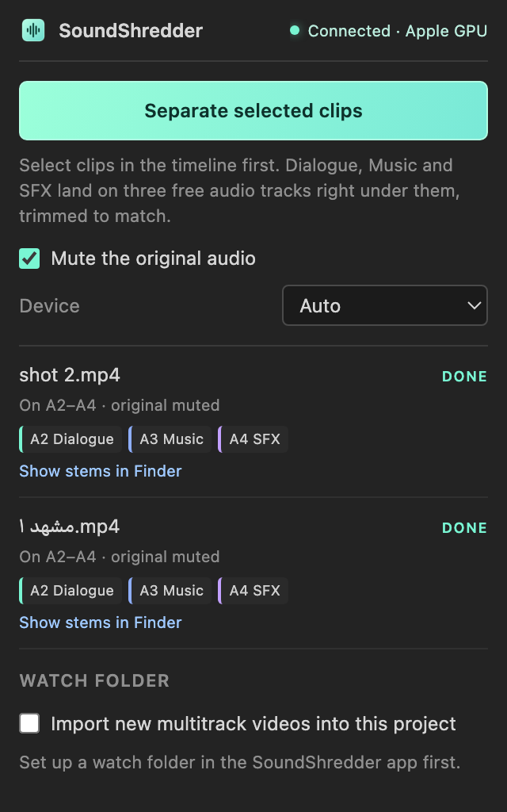

# SoundShredder for Premiere Pro

**Split any clip into Dialogue, Music and SFX inside your Premiere Pro timeline, in one click, on your own Mac.**

[SoundShredder](#credits) is a local AI audio separator made by **[cyr4x](https://x.com/_cyr4x)** for the Higgsfield community. This edition adds a **Premiere Pro panel** and a **watch folder**, so separated sound lands in your edit already on its own tracks, trimmed and in sync.

<p align="center">
  
</p>
<p align="center"><b>Select clips → Separate → Dialogue on A2 · Music on A3 · SFX on A4</b></p>

## Why it gets the job done

### One click in Premiere, stems already in place

- **Works from the timeline.** Select one clip or a whole scene and click **Separate selected clips**. No exporting, no round trips to another app.
- **Cut to your edit.** Each stem is trimmed to the clip's in and out points and placed at the clip's position, with the source's audio offset applied. Nothing to line up by hand.
- **Respects your timeline.** It finds three neighbouring audio tracks that are empty under the clip, never touches locked tracks, and adds tracks at the bottom only when it has to. Nothing you already edited is overwritten.
- **Original muted, not deleted.** The original audio is switched off so you hear the stems; turn it back on any time, or untick **Mute the original audio**.
- **Batch friendly.** Select many clips: they are separated one after another, with live progress for each clip in the panel.
- **Separate once, reuse instantly.** The whole source file is separated once. Every other cut of the same footage gets its stems straight away.
- **Tidy files.** Stems are saved next to the footage in `SoundShredder Stems/<clip> - Stems/` as `<clip> - Dialogue.wav`, `- Music.wav` and `- SFX.wav`, and imported into a **SoundShredder** bin.
- **Safe with tricky clips.** Speed-changed or reversed clips and nested sequences are listed as skipped instead of being placed out of sync.

### Watch folder: drop videos in, get multitrack files out

- Choose a folder and every new video dropped into it is separated automatically, as soon as copying has finished.
- Each result is a `<name> - Stems.mov` with the picture copied bit for bit (no re-encode) and one audio track per layer:

  | Track | Content |
  | --- | --- |
  | V1 | Original picture |
  | A1 | Dialogue |
  | A2 | Music |
  | A3 | Sound effects |
  | A4 | Original mix, for reference |

- Drag it into a sequence and every layer is already on its own track. The panel can import finished files into your open project for you.
- The queue is saved: videos added while the app was closed are picked up on the next launch.

### Local, fast and faithful

- Uses the **Bandit v2** cinematic source separation model, built for dialogue, music and effects in film and video.
- Runs **entirely on your computer**: the Apple GPU (Metal) on Apple Silicon, NVIDIA GPUs, or the CPU. Nothing is uploaded, and it works offline after the one-time model download (about 426 MB).
- **Lossless round trip:** the three stems add back up to the original (residual −56.8 dB, zero samples of lag in testing). Output is 24-bit WAV at the source's sample rate and exact length.
- Remix inside the app too: set each layer's level and export a clean mix, for example dialogue and effects without the music.
- Arabic and other non-Latin file names work end to end.

## Requirements

- macOS 12 or newer. Apple Silicon is recommended (it uses the GPU); Intel Macs run on the CPU.
- [Python 3.11](https://www.python.org/downloads/release/python-3119/) (macOS universal2 installer).
- Premiere Pro 2022 (version 22) or newer for the panel. Tested on Premiere Pro 2026.
- Clips up to 10 minutes and 500 MB per source file.

## Install

1. **Install Python 3.11** from the link above.
2. **Download this repository:** click **Code › Download ZIP**, unzip it, and move the folder to Documents (or any folder you can write to).
3. **Start SoundShredder:** double-click **Start SoundShredder.command**. The first launch installs everything it needs and opens the app at <http://127.0.0.1:7860>. Keep that window open while you work.
   - If macOS blocks it: open Terminal, type `bash ` (with a space), drag **Start SoundShredder.command** into the window and press Return.
   - Optional: build a real Mac app with its own window (needs the Xcode Command Line Tools): `bash mac-app/build_app.sh`
4. **Install the Premiere panel:** in Terminal, type `bash ` (with a space), drag **premiere-panel/install.sh** into the window and press Return. Or, from the SoundShredder folder:

   ```bash
   bash premiere-panel/install.sh
   ```

5. **Restart Premiere Pro** and open **Window › Extensions › SoundShredder**. The panel shows **Connected** while SoundShredder is open.

To remove the panel later, run `bash premiere-panel/uninstall.sh`.

## Use

**In Premiere:** keep SoundShredder open, select clips in the timeline, and click **Separate selected clips** in the panel. **Show stems in Finder** opens the saved files.

**Watch folder:** in the SoundShredder app, go to **04 · Watch a folder**, choose a folder and click **Start watching**. In the panel, tick **Import new multitrack videos into this project** to bring results into Premiere automatically.

**Single files:** drop any audio or video file into the app, listen to each layer, set the levels and download WAVs or a ZIP.

## Windows and Linux

The app runs there with a manual setup (see [MANUAL.md](MANUAL.md#manual-installation--other-operating-systems)): `python setup_runtime.py --device cuda` (or `--device cpu`), then start it with `.venv\Scripts\python.exe app.py` on Windows. The Premiere panel installer and the one-click launchers in this repository are for macOS only.

## More

- [MANUAL.md](MANUAL.md): every option, GPU notes, formats, limits, the command line tool, and what was improved around Bandit v2.
- [VERIFICATION.md](VERIFICATION.md): what was tested and how.

## Credits

- **SoundShredder** was created by **cyr4x** and made for the Higgsfield community. All credit for the original app, its separation pipeline and its interface goes to cyr4x: [X](https://x.com/_cyr4x) · [Higgsfield](https://higgsfield.ai/@cyr4x) · [Instagram](https://www.instagram.com/__cyr4x__/) · [YouTube](https://www.youtube.com/@cyr4xfilms).
- **This edition** adds the Premiere Pro panel (`premiere-panel/`), the watch folder and the multitrack .mov export.
- **Bandit v2** by Karn Watcharasupat and collaborators: [paper](https://arxiv.org/abs/2407.07275), [code](https://github.com/kwatcharasupat/bandit-v2) (Apache-2.0). The official checkpoint is [CC BY-SA 4.0](https://zenodo.org/records/12701995) and is downloaded on first use, not included here.
- **[bandit-infer](https://github.com/openmirlab/bandit-infer)** packages the model for inference.
- **Space Grotesk** font under the SIL Open Font License (`static/fonts/SpaceGrotesk-OFL.txt`). The Higgsfield mark belongs to Higgsfield; see `static/BRANDING.md`.

The original SoundShredder was shared without a license file, so the rights to it remain with cyr4x.

---

## بالعربي

**SoundShredder** برنامج بيفصل صوت أي فيديو أو كليب لـ **حوار وموسيقى ومؤثرات**، وبيشتغل على جهازك من غير إنترنت. البرنامج الأصلي من عمل **cyr4x** لمجتمع Higgsfield، وكل الفضل في البرنامج الأصلي له. النسخة دي ضافت عليه **لوحة جوه Premiere Pro** و**فولدر مراقبة**.

**مميزاته:**

- تحدد الكليبات في التايملاين وتدوس **Separate selected clips**، فالحوار والموسيقى والمؤثرات تنزل على 3 تراكات فاضية تحت الكليب، مقصوصة على قده ومظبوطة على الصورة.
- ما بيلمسش أي حاجة في المونتاج بتاعك: بيدوّر على تراكات فاضية، وبيتخطى التراكات المقفولة، وبيضيف تراكات جديدة بس لو محتاج.
- الصوت الأصلي بيتكتم، مش بيتمسح.
- تقدر تحدد مشهد كامل مرة واحدة، والكليبات بتتفصل ورا بعض.
- الملف الواحد بيتفصل مرة واحدة بس، وأي قطعة تانية منه بتاخد الستيمز على طول.
- فولدر المراقبة: أي فيديو جديد ينزل فيه بيطلع منه ملف `.mov` فيه الصورة زي ما هي، وكل صوت على تراك لوحده.
- بيشتغل على كارت الشاشة في ماك (Apple Silicon) أو NVIDIA أو المعالج، ومفيش أي حاجة بتترفع على النت.
- أسماء الملفات العربي شغالة عادي.

**التنصيب على ماك:**

1. نزّل **Python 3.11** من الرابط اللي فوق.
2. نزّل الريبو من **Code › Download ZIP** وفك الضغط وحط الفولدر في Documents.
3. دوس دبل كليك على **Start SoundShredder.command**. أول مرة بينزّل كل اللي محتاجه وبيفتح البرنامج. لو الماك منعه: افتح Terminal واكتب `bash ` واسحب الملف جوه ودوس Return.
4. لتنصيب لوحة بريمير: في Terminal اكتب `bash ` واسحب ملف **premiere-panel/install.sh** ودوس Return.
5. اقفل Premiere وافتحه تاني، وافتح **Window › Extensions › SoundShredder**.

خلي SoundShredder مفتوح وإنت شغال، واللوحة هتكتب **Connected**.
